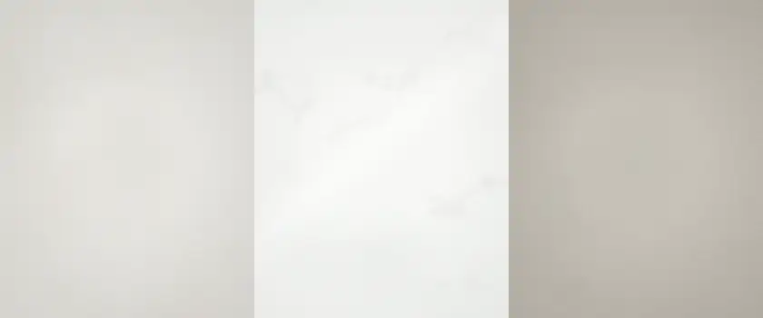
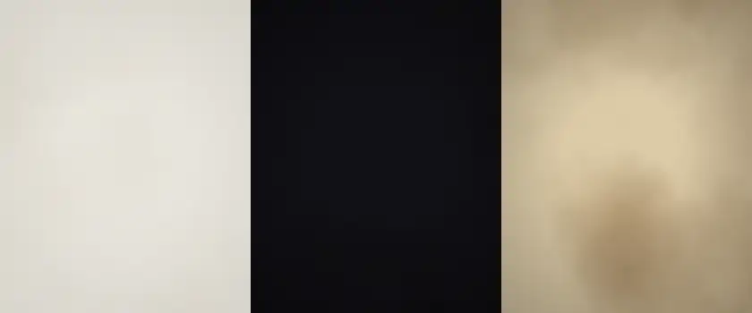
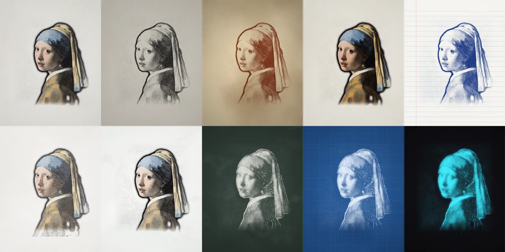
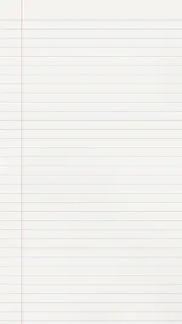
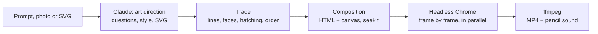

<div align="center">



# inkline

**Prompt in. Hand-drawn video out.**

A Claude skill that turns a sentence, a photo or an SVG into a video of it being drawn:
stroke by stroke, pencil in frame, then a colour wash and the sound of graphite on paper.
Rendered on your machine from HTML and JavaScript.

Open source (MIT) · needs Node.js 18+ · works in Claude Code and other agents that read skills

</div>

---

## Install

**Claude Code** (recommended)

```text
/plugin marketplace add SunFloat/inkline
/plugin install inkline@inkline
```

**Any agent that reads skills**

```bash
npx skills add SunFloat/inkline
```

**By hand**

```bash
git clone https://github.com/SunFloat/inkline
cp -r inkline/skills/inkline ~/.claude/skills/
```

Requirements: Node.js 18+. inkline uses the Chrome you already have (or fetches a headless one) and ships
its own ffmpeg. The first run sets everything up by itself.

## Use it

Just ask Claude:

> Draw my photo `~/Pictures/grandma.jpg` as a pencil sketch for Instagram Reels.

> Make a 15-second whiteboard video of a rocket launching. Just do it.

> Turn `logo.svg` into a gold-ink drawing, square, with sound.

> I want my own style: blue fineliner on warm paper, no colour at the end.

Claude picks the subject route, the medium, the format and the length. If you want a say, it asks a short
round of questions first (style, format, length, extras) and can save what you invent as a reusable style.

<div align="center">

</div>

## What it makes

| You give | inkline draws |
|---|---|
| **A photo** | A real pencil drawing of it: line work from a dodge-and-burn sketch, tone as hand hatching, revealed under the moving tool. On macOS and Windows the pencil starts at the eyes and draws the face finer. |
| **A sentence** | Claude writes the picture as SVG line art (contour, then features, then shading) and inkline performs it path by path. With an image tool connected, Claude can generate a photoreal subject first. |
| **An SVG** | Your paths, in document order, along their direction. Fills become the closing colour wash. |

Output: MP4 (H.264) or WebM, 1080p by default and larger with `--size`, a poster PNG and an optional GIF, in 9:16, 4:5, 1:1, 16:9, 3:4 or 4:3,
any length from 3 seconds to 10 minutes, with a procedural drawing sound synced to every stroke.

## Styles



| Style | Medium |
|---|---|
| `graphite` | HB pencil on cold-press paper, crosshatching, soft colour wash |
| `charcoal` | willow charcoal on grey Ingres paper |
| `sanguine` | red chalk on aged laid paper, Renaissance study |
| `watercolor` | sepia fineliner, then a watercolour wash |
| `ballpoint` | blue ballpoint in a ruled school notebook |
| `fineliner` | 0.3 mm ink on bristol, engraving-like |
| `whiteboard` | chisel dry-erase marker, blue shading |
| `chalkboard` | white chalk on slate |
| `blueprint` | technical pen on cyanotype |
| `neon` | light painting on black |
| `gold` | metallic gold ink on black card |

### Your own style

A style is a small JSON file that extends a preset. Ask Claude for one, or write it:

```json
{
  "name": "brand",
  "extends": "fineliner",
  "label": "Brand blue",
  "ink":   { "color": "#1f4fd8", "width": 1.8 },
  "paper": { "color": "#fffdf7" },
  "trace": { "hatch": "hatch", "hatchDensity": 0.45 },
  "pen":   { "tool": "marker" },
  "sound": { "kind": "marker" }
}
```

Save it to `.inkline/styles/brand.json` (this project) or `~/.inkline/styles/` (everywhere). Every key is
documented in [`references/styles.md`](skills/inkline/references/styles.md).

<div align="center">

</div>

## How it works



- **Trace.** Photos are analysed in the browser: contour and detail lines (difference of Gaussians with
  hysteresis, thinned and joined into long strokes), Chrome's face detection where available, a background
  matte, and shading as patches of hatching that follow the form. Strokes are ordered the way a person draws:
  face first, then outlines, details, and shading from light to dark.
- **Render.** The composition is an HTML page whose canvas is a pure function of time. Each stroke uncovers a
  finished pencil drawing under the tool (photos) or is drawn as a pressure-tapered line with hand wobble
  (SVG). Paper, whiteboard, slate and blueprint grounds and the drawing tools are generated in code.
- **Encode.** Several headless pages render disjoint frame ranges in parallel; ffmpeg joins them losslessly
  and adds a pencil, pen, marker or chalk track synthesised from the speed of every stroke.

Same input, style and seed always give identical frames.

## Command line

The skill drives a CLI you can also use directly:

```bash
SKILL=~/.claude/skills/inkline            # or wherever the skill lives
$SKILL/scripts/inkline render photo.jpg --style charcoal --format 4:5 --duration 20
$SKILL/scripts/inkline sheet photo.jpg --styles graphite,charcoal,ballpoint,neon   # compare looks
$SKILL/scripts/inkline preview drawing.svg --style whiteboard                      # scrub in the browser
$SKILL/scripts/inkline style brand --from fineliner --ink "#1f4fd8"                # save a style
$SKILL/scripts/inkline doctor                                                       # check the setup
```

All commands and flags: [`references/cli.md`](skills/inkline/references/cli.md).

## Repository

```text
skills/inkline/
  SKILL.md                 the skill: workflow, defaults, quality checks
  references/              question rounds, styles, SVG authoring, CLI
  scripts/inkline          launcher (sets up the engine on first run)
  engine/
    core/                  trace, sketch, materials, renderer, player (browser JS)
    src/                   CLI: pipeline, browser, ffmpeg, styles, audio
    styles/                the eleven presets
    test/                  unit and end-to-end tests  (npm test)
examples/                  SVGs written for inkline
site/                      the project page, runs the engine live in the browser
```

## Credits

Demo artworks are public domain, via Wikimedia Commons: Johannes Vermeer, *Girl with a Pearl Earring*
(c. 1665); Vincent van Gogh, *Self-Portrait* (1887); Leonardo da Vinci, *Mona Lisa* (c. 1503–1519);
Albrecht Dürer, *Young Hare* (1502). The fox and the lighthouse are SVGs written for inkline.

Fonts: Permanent Marker, Schibsted Grotesk and JetBrains Mono, under the SIL Open Font License.

MIT © 2026 Benjamin Buchta
